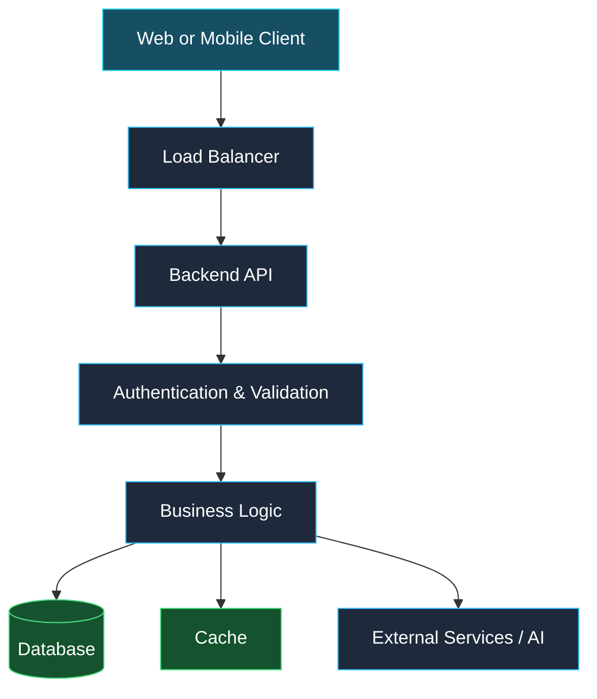

<!-- ===================== HERO SECTION ===================== -->

<div align="center">


<a href="https://git.io/typing-svg">

</a>

<br/>

<a href="https://github.com/amit81127">

</a>
<a href="https://www.linkedin.com/in/amit-kumar-prasad-55a070275/">

</a>
<a href="mailto:h2307190100015@gmail.com">

</a>
<a href="https://amitkumar8112.vercel.app/">

</a>


</div>

---

## 👨‍💻 About Me

```javascript
const amit = {
  name: "Amit Kumar Prasad",
  role: "Backend Developer @ DIMISI Technologies",
  education: "Final-Year B.Tech CSE | 2027 Batch",
  location: "Kanpur, India",

  backend: ["Node.js", "Express.js", "REST APIs"],
  frontend: ["React.js", "Next.js", "JavaScript"],
  databases: ["MongoDB", "MySQL", "Supabase"],
  languages: ["Java", "JavaScript", "Python", "C"],
  interests: [
    "System Design",
    "Scalable Backend Architecture",
    "RAG & LLM Applications",
    "Agentic AI & Multi-Agent Systems"
  ],

  mindset: "Learn → Build → Test → Improve"
};
```

- 💼 Working on backend engineering and API development.
- 🌐 Building full-stack applications with modern web technologies.
- 🤖 Exploring AI-powered applications, RAG pipelines, and agent orchestration.
- 🏗️ Learning caching, load balancing, database optimization, and scalable system design.
- 🧠 Strengthening Java, data structures, and algorithmic problem-solving.
- 🎯 Interested in impactful software engineering and AI engineering opportunities.

> **My philosophy:** Write clean code, understand the system, and build solutions that solve real problems.

---

## ⚡ Tech Arsenal

<div align="center">

### Languages


### Frontend Development


### Backend & Databases


### Tools & Infrastructure


</div>

<details>
<summary><b>🧠 AI & Intelligent Applications</b></summary>

<br/>

Currently exploring and developing skills in:

- Retrieval-Augmented Generation (RAG)
- Large Language Model (LLM) applications
- Embeddings and vector search
- AI agents and tool calling
- Multi-agent orchestration
- Prompt engineering and context management

</details>

<details>
<summary><b>🏗️ Backend & System Design</b></summary>

<br/>

Areas of focus:

- REST API design and authentication
- Database schema design, indexing, and query optimization
- Caching and request-performance optimization
- Load balancing and horizontal scaling
- Logging, monitoring, and error handling
- Docker, CI/CD, and cloud deployment fundamentals

</details>

---

## 🚀 Featured Projects

<div align="center">

<a href="https://github.com/amit81127/rating-website">

</a>
<a href="https://github.com/amit81127/Milan">

</a>

</div>

### ⭐ Rating Website
**React · Node.js · Express.js · MongoDB**

A full-stack rating and voting platform with backend APIs and an administration interface.

- Full-stack application architecture
- API-driven frontend and backend
- Database-backed rating workflows

🔗 [Source Code](https://github.com/amit81127/rating-website)

### 💬 Milan — AI Chat Application
**Next.js · AI · Authentication**

A modern chat application focused on AI-assisted conversations and a responsive web experience.

- AI-assisted conversational experience
- Modern web application architecture
- Chat-focused user interface

🔗 [Live Demo](https://milan-chat.vercel.app) · [Source Code](https://github.com/amit81127/Milan)

### 🏢 DIMISI-OPS
**React · TypeScript · TanStack · Backend APIs**

An operations-management platform focused on tasks, projects, employee workflows, and role-based authentication.

🔗 [Explore Repository](https://github.com/Cosmic-Aura-Tech-Industry-CATI/DIMISI-OPS) · [Live Application](https://dimisi-ops.vercel.app)

### 🚗 Smart Parking System
**IoT · Arduino · RFID · Servo Motors**

A hardware-software project exploring automated parking management and RFID-based access control.

### 🛍️ RetailMate — Smart Retail Assistant
**AI · Voice Interaction · NLP**

A smart retail assistant concept focused on conversational product discovery and retail queries.

<div align="center">

<a href="https://github.com/amit81127?tab=repositories">

</a>

</div>

---

## 🏛️ System Design Mindset

I am learning to design systems beyond the happy path: handling traffic, reducing latency, separating responsibilities, and improving reliability.



<sub>Illustrative learning architecture, not a claim that every component is deployed in my projects.</sub>

---

## 📊 GitHub Analytics

<div align="center">

<a href="https://github.com/amit81127">

</a>
<a href="https://github.com/amit81127">

</a>

<br/>


<br/>


</div>

---

## 🐍 Contribution Journey

<div align="center">


</div>

---

## 🎯 Current Focus

- [x] Build full-stack applications
- [x] Develop backend APIs and integrate databases
- [ ] Advance system design and backend scalability
- [ ] Build practical RAG-based applications
- [ ] Explore multi-agent orchestration and AI workflows
- [ ] Improve deployment, observability, and CI/CD practices

<sub>These checkboxes represent my learning roadmap; update them as milestones are completed.</sub>

---

## 🤝 Let's Connect & Build

I'm interested in connecting with developers, engineers, and builders who enjoy creating useful software and exploring emerging technologies.

<div align="center">

<a href="https://www.linkedin.com/in/amit-kumar-prasad-55a070275/">

</a>
<a href="mailto:h2307190100015@gmail.com">

</a>
<a href="https://github.com/amit81127">

</a>
<a href="https://amitkumar8112.vercel.app/">

</a>

<br/><br/>

**💡 Build boldly. Learn continuously. Ship thoughtfully.**


</div>
